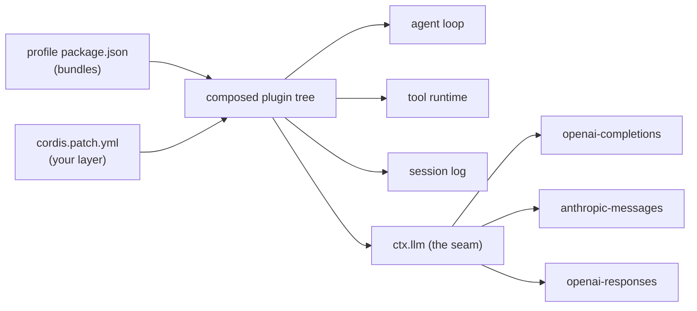

# harness-seam

English | [中文](README.zh.md)

**Model-agnostic profiles and an evaluation kit for DeepSeek Harness (MIT).**

Run the same agent harness — same tools, same loop, same session model — on a different model,
then measure whether it still feels the same.

> Status: P1. Tested on Windows with DeepSeek Harness 0.2.1-rc.2.

---

## Why

A harness is everything around the model: prompts, tools, loop, session state, compaction.
Swapping the model should change *how well* it acts, not *what it is allowed to do*.

This repo gives you two things:

1. **Profiles** that point a stock DeepSeek Harness install at any OpenAI-compatible endpoint,
   without touching the installed app.
2. **An eval kit** — six fixed cases with objective pass/fail checks — so "it feels worse"
   becomes a table.

## What this adds, and what it does not

DeepSeek Harness already ships a multi-provider adapter
(`@deepseek-ai/dsh-llm-pi-ai`). Pointing it at your own endpoint is a
configuration change, not a capability this repo invents.

What is actually missing — and what is here:

| Gap | Here |
|---|---|
| Profile files that work, including the permission-preset row tools need | `profiles/` |
| A way to tell whether a model still behaves well in the harness | `eval/` |
| Streaming `usage` for gateways that omit it | `patches/` |
| A map of how profiles compose and where the model seam sits | `docs/` |

If all you want is to switch models, one patch file is enough. Everything else
exists to answer a second question: **did it get worse?**

## How the pieces fit



## Quick start

Prerequisite: a DeepSeek Harness install (MIT, `@deepseek-ai/dsh*` packages) on Windows.

```powershell
# 1) create a profile from the stock web template
dsh --profile mine --from-default-profile web     # then Ctrl+C once it boots

# 2) drop one of the profile files from profiles/ into
#    %USERPROFILE%\.dsh\profiles\mine\   and edit the placeholders

# 3) verify the composition without starting anything
dsh --profile mine --dump-config | Select-String "llm-pi-ai|agent-default-model"

# 4) run
dsh --profile mine
```

See [`profiles/standard/`](profiles/standard/) for a three-route example
(your own gateway + OpenAI + Anthropic).

## Evaluation kit

```powershell
cd eval
node run.cjs                 # all six cases
node run.cjs --only c3_chain # one case
```

Cases cover: text-only output, single-tool retrieval, a multi-tool chain, instruction
adherence, error recovery, and a six-write long task. Every check is objective —
stdout content, file line counts, tool-call counts read back from the session log.

Baseline (Gemini 3.8 Flash via a local OpenAI-compatible bridge, 2026-10-18): **6/6**.

## Layout

```
profiles/
  standard/     # web profile: 32 tools, browser UI
  minimal/      # headless profile: one-shot tasks, no HTTP layer
eval/           # six cases, runner, objective checks
patches/        # small fixes for OpenAI-compatible gateways
docs/           # how the model seam works, and troubleshooting
```

## Troubleshooting

Four failures that cost us real time, all documented in
[docs/troubleshooting.md](docs/troubleshooting.md):

- tools blocked by `SetNamedSecurityInfoW failed (Win32 5)`
- `0 tok/s` because the gateway omits streaming `usage`
- `profile "desktop" is managed exclusively by the Electron application`
- tools never fire (three different causes)

## Limitations

- **Latency is dominated by the gateway**, not the harness. A local bridge that shells out
  to a CLI costs ~15-25 s per step; a direct API is far faster.
- **Tool schemas are expensive**: the standard profile ships ~32 tools, about 26k input
  tokens per request. That is the harness design, not a bug.
- Windows-first. The profile files are portable; the eval runner assumes PowerShell paths.

## What this is not

- Not a fork of DeepSeek Harness, and not affiliated with DeepSeek.
- Does not ship, proxy, or resell any model subscription. Bring your own endpoint and key.
- Does not document how to bypass authentication, integrity checks, or licensing.

## License

MIT for this repository's own content. DeepSeek Harness and its packages remain MIT,
Copyright (c) 2026 DeepSeek — see [NOTICE](NOTICE).
