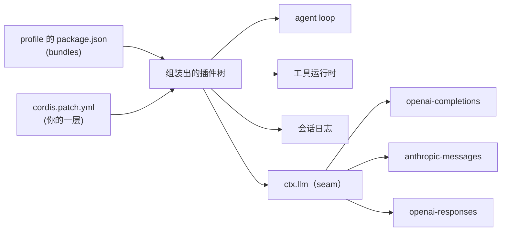

# harness-seam

[English](README.md) | 中文

**面向 DeepSeek Harness（MIT）的模型无关配置与评测工具。**

同一套 agent harness —— 同样的工具、同样的循环、同样的会话模型 —— 换一个模型来跑，
然后回答一个问题：**手感还一样吗？**

> 状态：P1。配置配方与评测工具现在可用，文档仍在补充。

---

## 为什么要这个

harness 是模型外面的一切：提示词、工具、循环、会话状态、压缩。
换模型应该改变它**做得多好**，而不改变它**能做什么**。

这个仓库提供两样东西：

1. **Profile 配方**——把原版 DeepSeek Harness 指向任意 OpenAI 兼容端点，且不修改安装目录；
2. **评测集**——六道固定题 + 客观判定，把"感觉变差了"变成一张表。

## 它加了什么，没加什么

DeepSeek Harness 本身就有多 provider 适配器（`@deepseek-ai/dsh-llm-pi-ai`）。
把它指向你自己的端点属于**改配置**，不是这个仓库发明的新能力。

真正缺的是这些：

| 缺口 | 这里提供 |
|---|---|
| 能直接用的 profile 文件（含工具必需的权限预设） | `profiles/` |
| 判断某个模型在这套 harness 里还稳不稳的方法 | `eval/` |
| 兼容网关不返回流式 `usage` 的修法 | `patches/` |
| profile 如何组装、模型 seam 在哪的一页说明 | `docs/` |

只想换模型的话，一个 patch 文件就够了。其余部分是为了回答第二个问题：
**它是不是变差了？**

## 各部分怎么咬合



## 快速开始

前提：Windows 上装好了 DeepSeek Harness（MIT，`@deepseek-ai/dsh*` 系列包）。

```powershell
# 1) 从官方 web 模板复制一个 profile
dsh --profile mine --from-default-profile web     # 启动后 Ctrl+C

# 2) 把 profiles/ 里的文件覆盖到
#    %USERPROFILE%\.dsh\profiles\mine\  并替换占位符

# 3) 只验证装配，不启动
dsh --profile mine --dump-config | Select-String "llm-pi-ai|agent-default-model"

# 4) 启动
dsh --profile mine
```

三路由示例（自己的网关 + OpenAI + Anthropic）见
[`profiles/standard/`](profiles/standard/)。

## 评测集

```powershell
cd eval
node run.cjs                 # 六道全跑
node run.cjs --only c3_chain # 只跑一道
```

覆盖：纯文本输出、单工具取事实、多工具链、指令遵守、错误恢复、六次写入的长任务。
所有判定都是客观的——stdout 内容、文件行数、从会话日志里读回的工具调用次数。

基线（Gemini 3.8 Flash，经本地 OpenAI 兼容桥，2026-10-18）：**6/6**。

## 目录

```
profiles/
  standard/     # web 档：32 工具 + 浏览器 UI
  minimal/      # headless 档：一次性任务，无 HTTP 层
eval/           # 六道题、跑批、客观判定
patches/        # 针对 OpenAI 兼容网关的小修
docs/           # 模型 seam 如何工作
```

## 已知限制

- **延迟主要取决于网关**，不是 harness。经 CLI 转发的本地桥每步约 15-25 秒；直连 API 会快得多。
- **工具 schema 很贵**：standard 档约 32 个工具，每次请求约 2.6 万 input token。这是 harness 的设计，不是 bug。
- **Windows 优先**。profile 文件是跨平台的；评测脚本假设 PowerShell 路径。

## 这个项目不是什么

- 不是 DeepSeek Harness 的 fork，与 DeepSeek 无关联。
- 不提供、不代理、不转售任何模型订阅。请自带端点和 key。
- 不介绍如何绕过鉴权、完整性校验或授权。

## 许可

本仓库自身内容采用 MIT。DeepSeek Harness 及其包仍为 MIT，
Copyright (c) 2026 DeepSeek —— 见 [NOTICE](NOTICE)。
